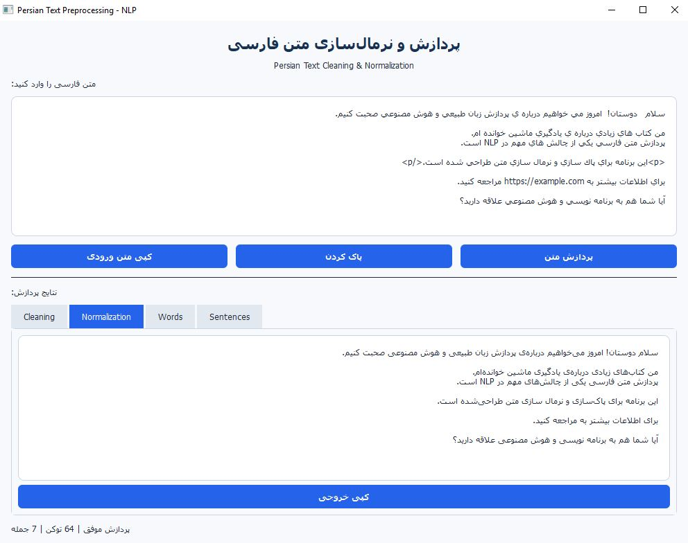

# Persian Text Preprocessing

**A desktop application for Persian text cleaning, normalization, and tokenization.**

`Python` · `Hazm` · `PySide6` · `Natural Language Processing`

**Documentation language:** [فارسی](#مستندات-فارسی) | [English](#english-documentation)

## Application Preview


<h2 align="center">Application Preview</h2>

<p align="center">
  
</p>


<!-- Uncomment after adding docs/preview.png:

-->

---

# مستندات فارسی

<div dir="rtl" align="right">

## معرفی پروژه

این پروژه یک برنامه دسکتاپ برای **پیش‌پردازش متن فارسی** است. کاربر متن خام را وارد می‌کند و می‌تواند خروجی مراحل پاک‌سازی، نرمال‌سازی و جداسازی واژه‌ها و جمله‌ها را در بخش‌های مجزا مشاهده و کپی کند.

این برنامه ابزار آماده‌سازی داده برای کارهای پردازش زبان طبیعی (NLP) است؛ **مدل هوش مصنوعی آموزش‌دیده یا ابزار تصحیح املای جامع نیست**.

## ویژگی‌ها

- پاک‌سازی متن از لینک‌ها، تگ‌های HTML، فاصله‌های اضافی و برخی نویسه‌های کنترلی و نامرئی
- نرمال‌سازی نوشتار فارسی با استفاده از کتابخانه Hazm
- یکسان‌سازی برخی نویسه‌های عربی و فارسی، مانند `ك` و `ک`، یا `ي` و `ی`
- جداسازی واژه‌ها و جمله‌ها با Hazm
- رابط کاربری گرافیکی با PySide6 و پشتیبانی از نمایش راست‌به‌چپ
- امکان ورود، ویرایش، کپی و پیست متن و کپی خروجی پردازش

## ابزارهای استفاده‌شده

| ابزار | نقش |
|---|---|
| Python | زبان برنامه‌نویسی |
| Hazm | نرمال‌سازی و توکن‌سازی فارسی |
| PySide6 | رابط گرافیکی دسکتاپ |
| re, html, unicodedata | عملیات پاک‌سازی و پردازش نویسه‌ها |

## نصب و اجرا

پیش‌نیاز: Python و دسترسی به pip. این پروژه در زمان توسعه با Python 3.13 استفاده شده است. برای نصب، در پوشه اصلی مخزن دستورات زیر را اجرا کنید:

</div>

```powershell
python -m venv .venv
.\.venv\Scripts\Activate.ps1
python -m pip install hazm PySide6
python gui.py
```

<div dir="rtl" align="right">

در سیستم‌های دیگر، دستور فعال‌سازی محیط مجازی ممکن است متفاوت باشد. در صورت وجود فایل `requirements.txt` هماهنگ با نسخه نهایی برنامه، می‌توانید به‌جای نصب مستقیم دو بسته از `python -m pip install -r requirements.txt` استفاده کنید.

## مراحل پردازش

1. **Cleaning (پاک‌سازی):** حذف موارد غیرضروری مانند URL، تگ HTML و فاصله‌های تکراری، بدون حذف کلی نشانه‌گذاری‌های معنادار.
2. **Normalization (نرمال‌سازی):** یکسان‌سازی حروف و برخی قواعد فاصله و نیم‌فاصله در زبان فارسی.
3. **Word Tokenization (جداسازی واژه‌ها):** تبدیل متن به فهرستی از توکن‌ها؛ توکن‌ها ممکن است نشانه‌های نگارشی را نیز شامل شوند.
4. **Sentence Tokenization (جداسازی جمله‌ها):** شناسایی مرز جمله‌ها با استفاده از قواعد کتابخانه Hazm.

## مثال

**ورودی:**

</div>

```text
سلام   دوستان! من كتاب هاي زيادي دارم و مي خواهم برنامه نويسي ياد بگيرم. https://example.com
```

<div dir="rtl" align="right">

**خروجی پاک‌سازی (نمونه):**

</div>

```text
سلام دوستان! من كتاب هاي زيادي دارم و مي خواهم برنامه نويسي ياد بگيرم.
```

<div dir="rtl" align="right">

**خروجی نرمال‌سازی (نمونه تقریبی):**

</div>

```text
سلام دوستان! من کتاب‌های زیادی دارم و می‌خواهم برنامه نویسی یاد بگیرم.
```

<div dir="rtl" align="right">

خروجی دقیق به نسخه Hazm و نوع متن ورودی وابسته است.

## محدودیت‌ها

- نرمال‌سازی تمام خطاهای املایی و تمام ترکیب‌های دارای نیم‌فاصله را اصلاح نمی‌کند.
- حذف همه نشانه‌های نگارشی یا کلمات توقف برای تمام کاربردهای NLP مناسب نیست؛ برنامه چنین ادعایی ندارد.
- تمرکز پردازش زبانی روی **متن فارسی** است و این مخزن موتور پردازش پیشرفته زبان انگلیسی ارائه نمی‌کند.
- متن شامل HTML پیچیده ممکن است برای استخراج دقیق‌تر به یک HTML parser نیاز داشته باشد.

## ساختار پروژه

</div>

```text
Persian-Text-Preprocessing/
├── gui.py              # Graphical desktop application
├── main.py             # Command-line prototype
├── README.md           # Project documentation
├── requirements.txt    # Dependencies (if added)
├── .gitignore          # Git exclusions (if added)
└── docs/
    └── preview.png     # Optional screenshot
```

---

# English Documentation

## Overview

**Persian Text Preprocessing** is a Python desktop application that demonstrates a practical preprocessing pipeline for **Persian-language text**. Users can paste raw text, run the pipeline, and inspect separate outputs for cleaning, normalization, word tokenization, and sentence tokenization.

The application is a **preprocessing utility**, not a trained AI model or a comprehensive spelling-correction system.

## Features

- Remove URLs, HTML tags, redundant whitespace, and selected control or invisible characters.
- Normalize Persian writing using Hazm.
- Standardize common Arabic/Persian character variants, such as `ك` → `ک` and `ي` → `ی`.
- Tokenize words and sentences using Hazm.
- Display results in separate tabs with a PySide6 graphical interface.
- Support copying and pasting input and copying the processed output.
- Offer improved right-to-left rendering for Persian text.

## Technology Stack

| Technology | Purpose |
|---|---|
| Python | Application logic |
| Hazm | Persian normalization and tokenization |
| PySide6 | Desktop graphical interface |
| Python standard library | Regular expressions, HTML entities, and Unicode handling |

## Installation and Running

Use Python with `pip`. The project was developed using Python 3.13 on Windows.

```powershell
git clone https://github.com/nazanin1377/Persian-Text-Preprocessing.git
cd Persian-Text-Preprocessing
python -m venv .venv
.\.venv\Scripts\Activate.ps1
python -m pip install hazm PySide6
python gui.py
```

If a verified `requirements.txt` is included in the repository, you can install dependencies using `python -m pip install -r requirements.txt` instead.

## Processing Pipeline

| Step | Operation | Explanation |
|---|---|---|
| 1 | Cleaning | Remove URLs, HTML tags, unwanted characters, and extra whitespace. |
| 2 | Normalization | Standardize Persian characters, spacing, and some half-space conventions. |
| 3 | Word tokenization | Split the normalized text into word-level tokens (possibly including punctuation). |
| 4 | Sentence tokenization | Split text into sentences using Hazm. |

## Example

**Raw input:**

```text
سلام   دوستان! من كتاب هاي زيادي دارم و مي خواهم برنامه نويسي ياد بگيرم. https://example.com
```

**After cleaning (illustrative):**

```text
سلام دوستان! من كتاب هاي زيادي دارم و مي خواهم برنامه نويسي ياد بگيرم.
```

**After normalization (illustrative):**

```text
سلام دوستان! من کتاب‌های زیادی دارم و می‌خواهم برنامه نویسی یاد بگیرم.
```

The exact output depends on the Hazm version and the input text.

## Limitations and Scope

- Normalization is not equivalent to complete spell checking.
- Some compound words may retain ordinary spaces rather than half-spaces.
- The application does not implement a dedicated English NLP pipeline; its target language is Persian.
- Complex HTML should be parsed with a dedicated HTML parser when precise text extraction is required.
- The app does not itself train, fine-tune, or run a language model.

## Contributing

Suggestions and bug reports can be submitted through GitHub Issues. Before requesting a new normalization rule, include an example input, observed output, and expected output.

---

**Repository:** https://github.com/nazanin1377/Persian-Text-Preprocessing
